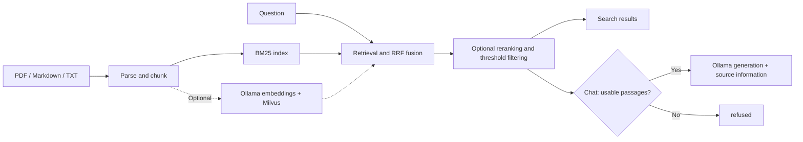

# Insight

**Local document search and question answering for meteorological reference materials.**

[简体中文](README.md) · [Report an issue](https://github.com/zhenkun26/Insight/issues)

[](https://github.com/zhenkun26/Insight/actions/workflows/ci.yml)
[](pyproject.toml)
[](LICENSE)

Insight turns PDF, Markdown, and TXT files into a searchable knowledge base. Find relevant passages, then use a local model to generate answers with source information. A web console and HTTP API support organizing meteorological documents, consulting procedures, and experimenting with RAG retrieval configurations.

Start with BM25 keyword search, which needs no model service, then add Ollama and Milvus for answer generation, vector search, and reranking. Documents, indexes, and sessions are stored locally by default. Running models through a local Ollama service requires no cloud model API key.

## Features

- **Document ingestion**: Import `.pdf`, `.md`, `.markdown`, and `.txt` files with available PDF page numbers and Markdown headings. Optional OCR handles PDF pages where text extraction returns no text.
- **Hybrid retrieval**: Combine BM25 and optional vector results with reciprocal rank fusion (RRF), followed by optional keyword-based or Ollama-based reranking.
- **Answers with sources**: Return retrieved passages, filenames, chunk IDs, and available page or section information. Return an explicit `refused` status when no passage passes the threshold.
- **Web console**: Upload documents, follow indexing progress, search passages, receive streamed answers, and inspect sources on one page.
- **Indexing and document management**: APIs expose job status, retries for eligible failed jobs, cancellation of queued jobs, and source/tag metadata editing.
- **Visible runtime behavior**: Inspect request trace IDs, stage timings, and retrieval fallback states. Vector-search or reranking failures preserve available baseline retrieval results.
- **Retrieval evaluation**: Compare BM25, vector, and hybrid retrieval with different reranking configurations using the included script.

## Quick start

The commands below use a macOS / Linux shell. You need **Python 3.11+**; repository CI uses Python 3.11. Installing dependencies requires network access. Keyword search does not need Ollama or a separate Milvus service at runtime.

### 1. Install and start

```bash
git clone https://github.com/zhenkun26/Insight.git
cd Insight

python3 -m venv .venv
source .venv/bin/activate
python -m pip install -e ".[dev]"

MILVUS_URI= python -m uvicorn app.main:app --host 127.0.0.1 --port 8000
```

Open the [web console](http://127.0.0.1:8000). The same service provides [interactive API documentation](http://127.0.0.1:8000/docs) and a [health endpoint](http://127.0.0.1:8000/health).

This command explicitly disables the vector store and starts with BM25. Document ingestion and keyword search work without Ollama. If a chat request retrieves passages while Ollama is unavailable, it reports a model error.

### 2. Import a document and search

1. Upload [`data/sample_docs/typhoon-warning.md`](data/sample_docs/typhoon-warning.md) in the console.
2. Wait for the indexing job to show `succeeded` and the document to show `indexed`.
3. Enter **台风预警信号分为几级？** in the search box (“How many levels of typhoon warning signals are there?”).
4. Inspect the matching passages, sections, and filenames.

You can also call the search API from another terminal:

```bash
curl -sS http://127.0.0.1:8000/search \
  -H 'Content-Type: application/json' \
  -d '{"query":"台风预警信号分为几级？","top_k":5}'
```

The response includes `retrieval_results`, `retrieval_status`, and `stages`. The bundled documents are synthetic examples for trying the workflow, not official meteorological guidance.

### 3. Enable local model answers

Install and start [Ollama](https://docs.ollama.com/quickstart), then download the project's default generation model:

```bash
ollama pull llama3.2:3b
```

The default Ollama address is `http://localhost:11434`. If the service is not running, start `ollama serve` in another terminal. Keep Insight running, ask a question in the console, or call:

```bash
curl -sS http://127.0.0.1:8000/chat \
  -H 'Content-Type: application/json' \
  -d '{"query":"台风预警信号分为几级？"}'
```

For streaming, use `/chat/stream` and add `-N` to curl. The current console and answer prompts primarily use Chinese. The default model is a configuration example; evaluate answer quality against your own documents.

## Optional configuration

The application reads environment variables and **does not load `.env` automatically**. See [`.env.example`](.env.example) for configuration examples and [`app/core/config.py`](app/core/config.py) for actual defaults.

To use a `.env` file, copy the example without overwriting existing settings, edit the values you need, and load it explicitly:

```bash
cp -n .env.example .env
python -m uvicorn app.main:app --env-file .env --host 127.0.0.1 --port 8000
```

Stop the previous Insight process before running this command. The example file sets `MILVUS_URI=data/milvus.db`, which attempts to enable Milvus Lite. Leave this value empty for keyword-only retrieval.

| Setting | Code default | Purpose |
| --- | --- | --- |
| `LLM_BASE_URL` | `http://localhost:11434` | Ollama service address |
| `LLM_MODEL` | `llama3.2:3b` | Answer generation model |
| `MILVUS_URI` | Empty | Empty disables vector storage; a file path selects Milvus Lite, a service URI selects Milvus Server |
| `EMBEDDING_MODEL` | `nomic-embed-text` | Embedding model |
| `TOP_K` / `CANDIDATE_K` | `5` / `20` | Final result count / candidates per retrieval branch |
| `SCORE_THRESHOLD` | `0.01` | Score threshold after fusion or reranking |
| `VECTOR_SCORE_THRESHOLD` | `0.7` | Similarity threshold for vector candidates |
| `ENABLE_RERANK` / `RERANKER_MODEL` | `false` / Empty | Enable reranking; an empty model name selects keyword-based scoring |
| `OCR_ENABLED` / `OCR_LANGUAGE` | `false` / `eng` | PDF OCR switch and Tesseract language |
| `DATABASE_PATH` | `data/insight.db` | SQLite document, job, and session records |

### Vector search and reranking

Before enabling vector search, download the default embedding model:

```bash
ollama pull nomic-embed-text
```

Set `MILVUS_URI=data/milvus.db` in `.env` and restart with the `--env-file` command above. Check the [Milvus Lite documentation](https://milvus.io/docs/milvus_lite.md) for platform requirements.

If you previously imported documents, submit a reindex job and use its returned `job_id` to check progress:

```bash
curl -sS -X POST http://127.0.0.1:8000/documents/reindex
```

After the job succeeds, inspect `retrieval_status.vector` in a search response: `ok` means vector retrieval completed normally for that request, `disabled` means it was not enabled, and `fallback:...` indicates a fallback.

Reranking is disabled by default. Set `ENABLE_RERANK=true` for keyword-based scoring. Also set `RERANKER_MODEL` to a downloaded Ollama generation model to use model-based scoring. This makes one model call per candidate and adds query latency.

### Scanned PDFs and containers

- **OCR**: Install Poppler (`pdftoppm`), Tesseract, and the required language data, then set `OCR_ENABLED=true`. For scanned Chinese documents, select installed Chinese language data, such as `OCR_LANGUAGE=chi_sim+eng`. OCR only supplements pages with no extracted text.
- **Docker**: The repository includes a [Dockerfile](Dockerfile) and [Compose configuration](docker-compose.yml) for the API, Milvus, etcd, and MinIO. Run Ollama separately and set `LLM_BASE_URL` to an address reachable from the API container; container-local `localhost` does not refer to the host machine. Compose publishes host ports by default, so adjust the bindings for your intended access scope.

## How it works



FastAPI serves the backend. SQLite stores documents, chunks, jobs, and sessions; the BM25 index defaults to `data/bm25.json`, and uploaded originals are saved under `data/uploads/`. The backend serves the HTML, CSS, and JavaScript console directly, with no separate frontend build step.

## API overview

| Endpoint | Purpose |
| --- | --- |
| `GET /health` | Service and dependency status |
| `POST /documents/upload` | Upload a document using multipart field `file`; returns an indexing job |
| `GET /documents` | List documents with source, tag, and status filters |
| `PATCH /documents/{document_id}/metadata` | Edit source, tags, and description |
| `POST /documents/reindex` | Submit a reindex job |
| `GET /jobs/{job_id}` | Inspect job progress and errors |
| `POST /jobs/{job_id}/retry` | Retry an eligible failed job |
| `POST /jobs/{job_id}/cancel` | Cancel a queued job that has not started |
| `POST /search` | Search passages with `source`, `tag`, and `document_ids` scope filters |
| `POST /chat` | Return an answer, sources, and workflow status |
| `POST /chat/stream` | Stream stage, source, and text events over SSE |

See the running service's [API documentation](http://127.0.0.1:8000/docs) for full request and response schemas. Chat API requests can include a `session_id` to retain bounded history. History provides conversational context, not document evidence.

## Development and verification

After installing the development dependencies above, run from the repository root:

```bash
ruff check app tests scripts
pytest
python scripts/evaluate.py --retrieval-mode bm25 --output evaluation-bm25.json
```

The BM25 evaluation makes no model-service calls. Run `python scripts/evaluate.py --help` for other configurations. For example, compare hybrid retrieval using a downloaded embedding model:

```bash
python scripts/evaluate.py \
  --retrieval-mode hybrid \
  --vector-backend memory \
  --embedding-model nomic-embed-text \
  --output evaluation-hybrid.json
```

Reports include hit rate, MRR, stage timings, and refusal-related metrics. Here, `refusal_accuracy` measures whether questions labeled for refusal produce empty retrieval results; it **does not measure the factual correctness of generated answers**. The bundled data is intended for regression checks and demonstrations. It does not replace human evaluation on real operational documents.

Main code locations:

| Path | Contents |
| --- | --- |
| [`app/api/`](app/api/) | HTTP routes and request orchestration |
| [`app/ingestion/`](app/ingestion/) | Parsing, chunking, and OCR |
| [`app/retrieval/`](app/retrieval/) | BM25, vector stores, and hybrid retrieval |
| [`app/services/`](app/services/) | Catalog, jobs, Ollama, QA, and sessions |
| [`app/web/`](app/web/) | Web console |
| [`scripts/evaluate.py`](scripts/evaluate.py) | Retrieval evaluation entry point |
| [`tests/`](tests/) | Automated tests |

## Current limitations

- **Sources support manual checking**: Prompts instruct the model to answer from documents and cite sources. The application does not yet validate each answer claim against its citations. Retrieval scores are not answer-confidence scores.
- **Search and chat scopes differ**: `/search` supports document scope filters; `/chat` and `/chat/stream` currently do not apply those filter parameters.
- **Designed for local use**: The API has no user authentication or permission isolation. The quick start binds to `127.0.0.1`; add access controls before sharing access. Configuring a remote model service sends the relevant queries or document passages to that service.
- **Format and domain boundaries**: Word documents are not supported. Review extraction quality for complex PDFs and scanned pages. Verify operational meteorological decisions against the applicable original documents.

## Help and contributions

Maintained by [zhenkun26](https://github.com/zhenkun26). Use [GitHub Issues](https://github.com/zhenkun26/Insight/issues) for questions, bugs, and feature requests. Pull requests for code and documentation improvements are welcome.

For bug reports, include reproduction steps, your Python version, relevant configuration, and error status. Remove sensitive documents and credentials. Before submitting code changes, run lint, relevant tests, and any affected retrieval evaluations.

## License

Released under the [MIT License](LICENSE). Models and imported documents remain subject to their own licenses.
