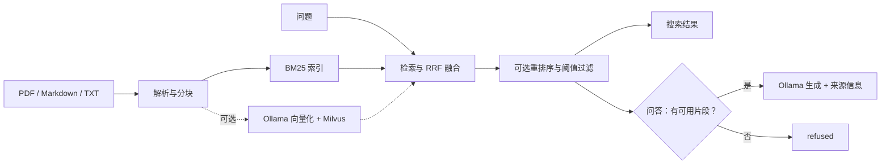

# 洞察者 · Insight

**面向气象业务文档的本地知识库检索与问答工具。**

[English](README-en.md) · [问题反馈](https://github.com/zhenkun26/Insight/issues)

[](https://github.com/zhenkun26/Insight/actions/workflows/ci.yml)
[](pyproject.toml)
[](LICENSE)

Insight 将 PDF、Markdown 和 TXT 资料转为可检索的知识库，帮助你查找相关段落，并通过本地模型生成附带来源信息的回答。它提供一个网页控制台和一组 HTTP API，适合整理气象业务资料、查阅流程说明，以及实验不同的 RAG 检索配置。

从无需模型服务的 BM25 关键词检索开始，再按需接入 Ollama 和 Milvus，启用回答生成、向量检索与重排序。资料、索引和会话默认保存在本地；使用本机 Ollama 模型时，无需云端模型 API 密钥。

## 主要功能

- **文档导入**：支持 `.pdf`、`.md`、`.markdown`、`.txt`，保留可提取的 PDF 页码与 Markdown 章节信息；可选 OCR 处理未提取到文本的 PDF 页面。
- **混合检索**：BM25 关键词召回与可选向量召回通过 RRF（倒数排名融合）合并，可进一步使用关键词规则或 Ollama 模型重排序。
- **带来源的问答**：返回检索片段、文件名、片段 ID 及可用的页码、章节；无片段通过阈值时返回明确的 `refused` 状态。
- **网页控制台**：在同一页面上传资料、查看索引进度、搜索片段、接收流式回答并查看来源。
- **索引任务与资料管理**：API 提供任务状态、符合条件的失败任务重试、排队任务取消，以及资料来源和标签编辑。
- **运行状态可见**：返回请求追踪 ID、阶段耗时和检索降级状态；向量检索或重排序失败时保留可用的基础检索结果。
- **可比较的检索评估**：使用内置脚本比较 BM25、向量和混合检索，以及不同重排序配置。

## 快速开始

以下命令适用于 macOS / Linux shell。需要 **Python 3.11+**；仓库 CI 使用 Python 3.11。安装依赖需要网络，关键词检索运行时不需要 Ollama 或独立 Milvus 服务。

### 1. 安装并启动

```bash
git clone https://github.com/zhenkun26/Insight.git
cd Insight

python3 -m venv .venv
source .venv/bin/activate
python -m pip install -e ".[dev]"

MILVUS_URI= python -m uvicorn app.main:app --host 127.0.0.1 --port 8000
```

打开 [网页控制台](http://127.0.0.1:8000)。[交互式 API 文档](http://127.0.0.1:8000/docs) 和 [健康检查](http://127.0.0.1:8000/health) 也由同一服务提供。

这条启动命令显式关闭向量存储，先使用 BM25。未启动 Ollama 时，文档导入和关键词检索仍可使用；有检索结果的问答请求会报告模型不可用。

### 2. 导入资料并检索

1. 在控制台上传 [`data/sample_docs/typhoon-warning.md`](data/sample_docs/typhoon-warning.md)。
2. 等待索引任务显示 `succeeded`，资料状态显示 `indexed`。
3. 在检索框输入：**台风预警信号分为几级？**
4. 查看命中的片段、章节与文件名。

也可以在另一个终端调用检索接口：

```bash
curl -sS http://127.0.0.1:8000/search \
  -H 'Content-Type: application/json' \
  -d '{"query":"台风预警信号分为几级？","top_k":5}'
```

返回结果包含 `retrieval_results`、`retrieval_status` 和 `stages`。内置样例是合成演示资料，仅用于体验流程，不代表官方气象业务规范。

### 3. 启用本地模型问答

安装并启动 [Ollama](https://docs.ollama.com/quickstart)，然后下载项目默认使用的生成模型：

```bash
ollama pull llama3.2:3b
```

Ollama 默认服务地址为 `http://localhost:11434`。若服务尚未启动，可在另一个终端运行 `ollama serve`。保持 Insight 运行，回到控制台的问答区提问，或调用：

```bash
curl -sS http://127.0.0.1:8000/chat \
  -H 'Content-Type: application/json' \
  -d '{"query":"台风预警信号分为几级？"}'
```

需要流式输出时，改用 `/chat/stream` 并为 curl 添加 `-N`。当前控制台和问答提示词以中文为主。默认模型是配置示例，实际回答质量需要结合自己的资料验证。

## 可选配置

程序从环境变量读取配置，**不会自行加载 `.env`**。完整变量示例见 [`.env.example`](.env.example)，实际默认值见 [`app/core/config.py`](app/core/config.py)。

如果使用 `.env`，请先复制示例文件（已有配置时保留原文件），再编辑所需值，并显式加载：

```bash
cp -n .env.example .env
python -m uvicorn app.main:app --env-file .env --host 127.0.0.1 --port 8000
```

运行前先停止上一条 Insight 启动命令。示例文件设置了 `MILVUS_URI=data/milvus.db`，会尝试启用 Milvus Lite；只使用关键词检索时，将该值留空。

| 配置项 | 代码默认值 | 用途 |
| --- | --- | --- |
| `LLM_BASE_URL` | `http://localhost:11434` | Ollama 服务地址 |
| `LLM_MODEL` | `llama3.2:3b` | 回答生成模型 |
| `MILVUS_URI` | 空 | 留空关闭向量存储；文件路径用于 Milvus Lite，服务 URI 用于 Milvus Server |
| `EMBEDDING_MODEL` | `nomic-embed-text` | 向量化模型 |
| `TOP_K` / `CANDIDATE_K` | `5` / `20` | 最终返回数 / 每路召回候选数 |
| `SCORE_THRESHOLD` | `0.01` | 融合或重排序后的分数阈值 |
| `VECTOR_SCORE_THRESHOLD` | `0.7` | 向量候选的相似度阈值 |
| `ENABLE_RERANK` / `RERANKER_MODEL` | `false` / 空 | 开启重排序；模型名为空时使用关键词规则 |
| `OCR_ENABLED` / `OCR_LANGUAGE` | `false` / `eng` | PDF OCR 开关与 Tesseract 语言 |
| `DATABASE_PATH` | `data/insight.db` | SQLite 资料、任务与会话记录 |

### 向量检索与重排序

启用向量检索前，下载默认的向量化模型：

```bash
ollama pull nomic-embed-text
```

在 `.env` 中设置 `MILVUS_URI=data/milvus.db`，按上面的 `--env-file` 命令重启。Milvus Lite 的平台要求见 [官方文档](https://milvus.io/docs/milvus_lite.md)。

如果此前已经导入资料，再提交一次重建索引任务，并通过返回的 `job_id` 查询进度：

```bash
curl -sS -X POST http://127.0.0.1:8000/documents/reindex
```

确认任务成功后，在检索响应中检查 `retrieval_status.vector`：`ok` 表示该次向量检索正常，`disabled` 表示未启用，`fallback:...` 表示发生降级。

重排序默认关闭。设置 `ENABLE_RERANK=true` 可使用关键词规则；同时设置 `RERANKER_MODEL` 为已下载的 Ollama 生成模型名称，则使用模型评分。它会逐个候选调用模型，增加查询耗时。

### 扫描 PDF 与容器配置

- **OCR**：额外安装 Poppler（`pdftoppm`）、Tesseract 及所需语言包，设置 `OCR_ENABLED=true`。中文扫描资料需选择已安装的中文语言包，例如 `OCR_LANGUAGE=chi_sim+eng`。OCR 仅补充没有提取到文本的页面。
- **Docker**：仓库提供 [Dockerfile](Dockerfile) 和 [Compose 配置](docker-compose.yml)，组合 API、Milvus、etcd 与 MinIO。Ollama 需单独运行；`LLM_BASE_URL` 必须是 API 容器可访问的地址，容器内的 `localhost` 不指向宿主机。默认 Compose 会发布宿主机端口，运行前应按自己的访问范围调整。

## 工作方式



后端使用 FastAPI；SQLite 保存文档、片段、任务及会话，BM25 索引默认写入 `data/bm25.json`，上传原件保存到 `data/uploads/`。前端是由后端直接托管的 HTML、CSS 和 JavaScript，无需独立的前端构建流程。

## API 概览

| 接口 | 用途 |
| --- | --- |
| `GET /health` | 服务与依赖状态 |
| `POST /documents/upload` | 以 multipart 字段 `file` 上传文档，返回索引任务 |
| `GET /documents` | 列出资料，支持来源、标签与状态筛选 |
| `PATCH /documents/{document_id}/metadata` | 编辑来源、标签和描述 |
| `POST /documents/reindex` | 提交重建索引任务 |
| `GET /jobs/{job_id}` | 查询任务进度与错误 |
| `POST /jobs/{job_id}/retry` | 重试符合条件的失败任务 |
| `POST /jobs/{job_id}/cancel` | 取消尚未开始运行的排队任务 |
| `POST /search` | 检索片段，支持 `source`、`tag`、`document_ids` 范围筛选 |
| `POST /chat` | 返回回答、来源和工作流状态 |
| `POST /chat/stream` | 通过 SSE 返回阶段、来源和文本事件 |

完整请求与响应结构见运行后的 [API 文档](http://127.0.0.1:8000/docs)。API 问答可传入 `session_id` 保留有限历史；历史用于对话上下文，不作为文档证据。

## 开发与验证

安装上述开发依赖后，在仓库根目录运行：

```bash
ruff check app tests scripts
pytest
python scripts/evaluate.py --retrieval-mode bm25 --output evaluation-bm25.json
```

BM25 评估不调用模型服务。其他配置可通过 `python scripts/evaluate.py --help` 查看，例如使用已下载的向量化模型比较混合检索：

```bash
python scripts/evaluate.py \
  --retrieval-mode hybrid \
  --vector-backend memory \
  --embedding-model nomic-embed-text \
  --output evaluation-hybrid.json
```

报告包含命中率、MRR、阶段耗时与拒答相关指标。这里的 `refusal_accuracy` 衡量标注为应拒答的问题是否返回空检索结果，**不衡量生成答案的事实正确性**。内置数据用于回归和演示，不能替代真实业务语料上的人工评估。

主要代码入口：

| 路径 | 内容 |
| --- | --- |
| [`app/api/`](app/api/) | HTTP 路由与接口编排 |
| [`app/ingestion/`](app/ingestion/) | 文档解析、分块与 OCR |
| [`app/retrieval/`](app/retrieval/) | BM25、向量存储与混合检索 |
| [`app/services/`](app/services/) | 资料管理、任务、Ollama、问答和会话 |
| [`app/web/`](app/web/) | 网页控制台 |
| [`scripts/evaluate.py`](scripts/evaluate.py) | 检索评估入口 |
| [`tests/`](tests/) | 自动化测试 |

## 当前边界

- **来源信息辅助核对**：系统通过提示词要求基于资料回答并引用来源，尚未实现逐条答案与引用的一致性验证。检索分数也不是答案可信度。
- **检索与问答范围有区别**：`/search` 支持文档范围筛选；当前 `/chat` 和 `/chat/stream` 不应用这些筛选参数。
- **面向本地使用**：API 未实现用户认证或权限隔离。快速开始仅绑定 `127.0.0.1`；如需共享访问，应先补齐访问控制。配置远程模型地址会将相应查询或文档片段发送至该服务。
- **格式与业务适用性**：暂不支持 Word 文档。复杂 PDF 和扫描件的解析质量需核对；涉及正式气象业务判断时，应回到有效的原始业务文件复核。

## 反馈与贡献

项目由 [zhenkun26](https://github.com/zhenkun26) 维护。使用问题、缺陷和功能建议可提交至 [GitHub Issues](https://github.com/zhenkun26/Insight/issues)，代码或文档改进欢迎提交 Pull Request。

报告问题时，请附上复现步骤、Python 版本、相关配置项和错误状态，并去除敏感资料与凭据。提交代码改动前，请运行 lint、相关测试和受影响的检索评估。

## 许可证

采用 [MIT License](LICENSE)。模型和导入资料分别遵循其自身许可。
